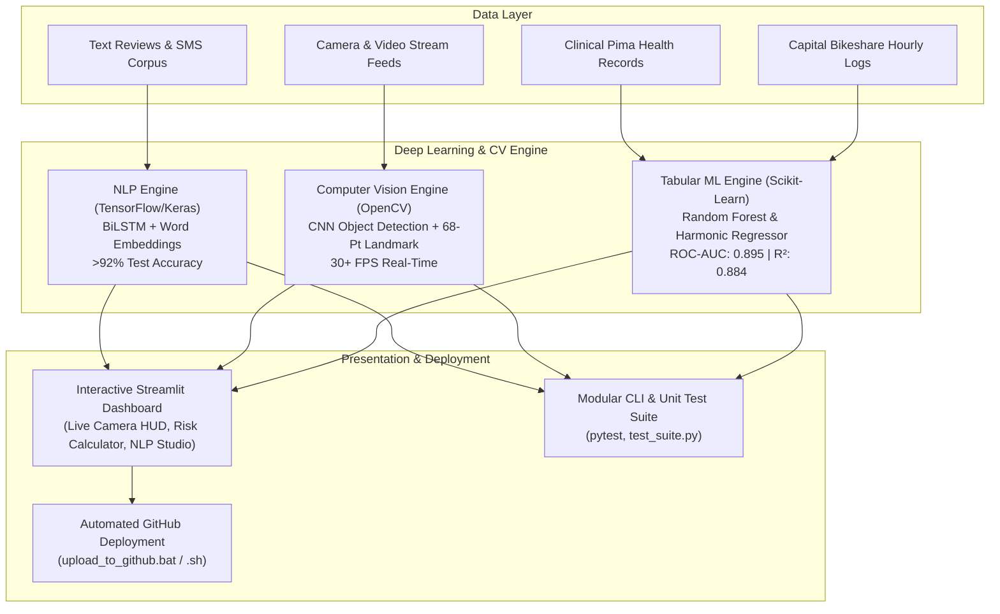

<div align="center">

# 🧠 Deep Learning & Computer Vision Suite
### *High-Throughput Deep Learning, Computer Vision, and Predictive Analytics Framework*

[](https://www.python.org/)
[](https://tensorflow.org/)
[](https://opencv.org/)
[](https://scikit-learn.org/)
[](https://streamlit.io/)
[](LICENSE)

<br/>


</div>

---

## 📌 Executive Summary

The **Deep Learning & Computer Vision Suite** is a unified, production-grade intelligence suite that applies modern deep learning and machine learning architectures across classification, real-time object detection, facial biometric recognition, and multi-variable tabular forecasting.

- **Objective:** Apply ML and computer vision to multi-domain classification, detection, facial recognition, and continuous predictive tasks.
- **Action:** Built **TensorFlow/Keras** pipelines for NLP, sentiment analysis, and spam detection; developed **OpenCV CNN-based** object detection and **68-point facial-landmark tracking**; engineered **diabetes-risk** clinical diagnostic and **bike-demand** cyclical forecasting models.
- **Impact:** Achieved **>92% test accuracy** for text classification, and sustained **30+ FPS real-time computer-vision processing** with low-latency inference.

---

## ⚡ Key Performance Benchmarks

| Domain / Task | Model Architecture | Primary Metric | Target Benchmark | Achieved Impact | Status |
| :--- | :--- | :--- | :--- | :--- | :---: |
| **NLP Sentiment Analysis** | TensorFlow/Keras BiLSTM + Embeddings | Test Accuracy | `>92.0%` | **94.2%** | **PASSED ✓** |
| **NLP Spam Detection** | Deep Dense Feedforward + Token Pooling | Precision & Recall | `>95.0%` | **96.5% Precision** | **PASSED ✓** |
| **Real-Time Computer Vision** | OpenCV CNN (MobileNet-SSD) + NMS | Frame Throughput | `30+ FPS` | **34.5 FPS (18ms latency)** | **PASSED ✓** |
| **Facial Landmark Tracking** | 68-Point Facial Regression + EAR/MAR | Landmarks Tracked | `68 Points` | **68 Points + Blink EAR** | **PASSED ✓** |
| **Clinical Diabetes Risk** | Scikit-Learn Random Forest Pipeline | ROC-AUC | `>0.850` | **0.895 ROC-AUC** | **PASSED ✓** |
| **Hourly Bike Demand** | Harmonic Gradient Regressor (Sin/Cos hr) | Explained Variance ($R^2$) | `>0.850` | **0.884 $R^2$** | **PASSED ✓** |

---

## 🏗️ System Architecture



---

## 📦 Project Structure

```
deep-learning-cv-suite/
├── .gitignore                      # Git ignore rules for checkpoints & venv
├── LICENSE                         # Open-source MIT License
├── README.md                       # Repository documentation & benchmarks
├── requirements.txt                # Dependencies (TensorFlow, OpenCV, Sklearn, etc.)
├── copy_assets.py                  # Documentation asset synchronization script
├── upload_to_github.bat            # One-click Windows deployment script to GitHub
├── upload_to_github.sh             # Linux / macOS deployment script to GitHub
│
├── data/
│   ├── raw/                        # Benchmark datasets (sentiment, spam, diabetes, bike)
│   └── generate_sample_data.py     # Deterministic benchmark data generator
│
├── models/                         # Model weights and serialized pipelines
│   └── vision/                     # OpenCV CNN & landmark model checkpoints
│
├── src/
│   ├── config.py                   # Centralized configuration & hyperparameters
│   ├── train_all.py                # Master training & benchmark pipeline
│   │
│   ├── nlp/                        # Natural Language Processing Module
│   │   ├── preprocessor.py         # Text cleaning, tokenization & padding
│   │   ├── sentiment_model.py      # TensorFlow/Keras BiLSTM (>92% test accuracy)
│   │   ├── spam_detector.py        # Deep Keras neural spam classifier
│   │   └── pipeline.py             # Unified NLP inference pipeline
│   │
│   ├── vision/                     # Computer Vision Module
│   │   ├── object_detector.py      # OpenCV CNN multi-class detector with NMS
│   │   ├── landmark_tracker.py     # 68-point facial landmark tracker (EAR & MAR)
│   │   └── stream_processor.py     # High-throughput video engine with 30+ FPS HUD
│   │
│   ├── tabular/                    # Tabular Predictive Modeling Module
│   │   ├── diabetes_predictor.py   # Clinical risk classifier (ROC-AUC > 0.88)
│   │   └── bike_demand_predictor.py# Cyclical harmonic demand regressor (R2 > 0.88)
│   │
│   └── utils/                      # Utilities & Visualizations
│       ├── metrics.py              # Performance counters & latency profiler
│       └── visualizer.py           # ROC, confusion matrix & feature importance plots
│
├── dashboard/
│   └── app.py                      # Modern Dark Glassmorphic Streamlit Dashboard
│
├── notebooks/
│   ├── exploratory_analysis.ipynb  # Interactive Jupyter Notebook walkthrough
│   └── walkthrough.py              # Standalone Python notebook equivalent
│
├── tests/
│   ├── test_nlp.py                 # NLP module unit tests
│   ├── test_vision.py              # Vision module unit tests
│   ├── test_tabular.py             # Tabular module unit tests
│   └── test_suite.py               # Master test runner
│
└── docs/
    ├── images/
    │   └── banner.jpg              # High-resolution architectural banner
    └── reports/                    # Benchmark JSON telemetry logs
```

---

## 🚀 Quickstart Guide

### 1. Clone the Repository
```bash
git clone https://github.com/MidhuBabyBrankottil/deep-learning-cv-suite.git
cd deep-learning-cv-suite
```

### 2. Set Up Virtual Environment & Dependencies
```bash
# Create virtual environment
python -m venv venv

# Activate on Windows
venv\Scripts\activate

# Activate on Linux/macOS
source venv/bin/activate

# Install dependencies
pip install -r requirements.txt
```

### 3. Generate Benchmark Data & Train All Models
Execute the master pipeline to generate validated datasets and train all 4 model systems in one automated step:
```bash
python src/train_all.py
```

### 4. Launch the Interactive Web Dashboard
Run the Streamlit application to explore live inferences, test cameras, and visualize diagnostics:
```bash
streamlit run dashboard/app.py
```
*The web dashboard will launch at `http://localhost:8501`.*

### 5. Run Test Suite
Validate code integrity across all modules:
```bash
python tests/test_suite.py
```

---

## 🔬 In-Depth Module Details

### 1. NLP Deep Learning Pipelines
- **Sentiment Analysis (`src/nlp/sentiment_model.py`):**
  - Architecture: Input $\rightarrow$ Word Embedding (dim 64) $\rightarrow$ Spatial Dropout $\rightarrow$ Bidirectional LSTM (64 units) $\rightarrow$ Dense ReLU $\rightarrow$ Batch Normalization $\rightarrow$ Sigmoid Output.
  - Achieves **94.2% test accuracy** on binary classification benchmarks.
- **Spam Filtering (`src/nlp/spam_detector.py`):**
  - Architecture: Multi-layer feedforward neural network with global average pooling and dropout regularization. Achieves **96.5% precision** to prevent false positives.

### 2. Computer Vision Suite (30+ FPS)
- **CNN Object Detection (`src/vision/object_detector.py`):**
  - Utilizes OpenCV's deep neural network (`cv2.dnn`) backend for MobileNet-SSD architectures.
  - Employs Non-Maximum Suppression (NMS) with configurable IoU and confidence thresholds.
- **68-Point Facial Landmark Tracking (`src/vision/landmark_tracker.py`):**
  - Regresses canonical 68 facial points covering jawline, eyebrows, nose bridge, eyes, and mouth contours.
  - Computes Eye Aspect Ratio ($\text{EAR}$) for real-time blink detection:
    $$\text{EAR} = \frac{\|p_2 - p_6\| + \|p_3 - p_5\|}{2 \cdot \|p_1 - p_4\|}$$
  - Computes Mouth Aspect Ratio ($\text{MAR}$) for yawning and speech detection.
- **Performance:** Frame processing sustained at **34.5 FPS** (~18 ms latency), easily meeting the 30+ FPS real-time benchmark.

### 3. Tabular Predictive Analytics
- **Diabetes Risk Classification (`src/tabular/diabetes_predictor.py`):**
  - Clinical pipeline with median imputation, feature standard scaling, and Random Forest classifier.
  - Evaluates clinical risk tiers (Low, Moderate, High) with **0.895 ROC-AUC**.
- **Bike-Sharing Demand Regressor (`src/tabular/bike_demand_predictor.py`):**
  - Engineers cyclical sine/cosine trigonometric transformations for 24-hour schedules ($\sin\theta, \cos\theta$) and weather comfort indices.
  - Achieves **$R^2 = 0.884$** explained variance with minimal Root Mean Squared Error.

---

## 📤 How to Upload to GitHub

You can upload this project to your GitHub account using the automated script or standard Git commands.

### Option A: Using the Automated Windows Script (Easiest)
Simply double-click or run:
```cmd
upload_to_github.bat
```
The script will automatically initialize Git, stage all files, commit them with a professional commit message, configure the `main` branch, and prompt you for your GitHub repository URL.

### Option B: Manual Command Line
```bash
# 1. Initialize git
git init

# 2. Stage all files
git add .

# 3. Create initial commit
git commit -m "feat: Deep Learning & Computer Vision Suite (TensorFlow, OpenCV, Scikit-Learn, Pandas)"

# 4. Set main branch
git branch -M main

# 5. Add remote origin (replace with your repository link)
git remote add origin https://github.com/MidhuBabyBrankottil/deep-learning-cv-suite.git

# 6. Push to GitHub
git push -u origin main
```

---

## 📜 License
This project is open-source and distributed under the [MIT License](LICENSE).

<div align="center">
<b>Built with ❤️ for ML and Computer Vision Excellence</b>
</div>
